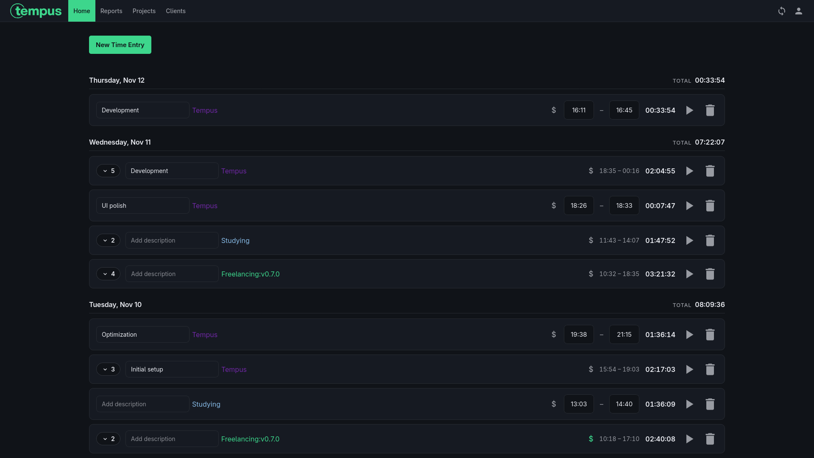
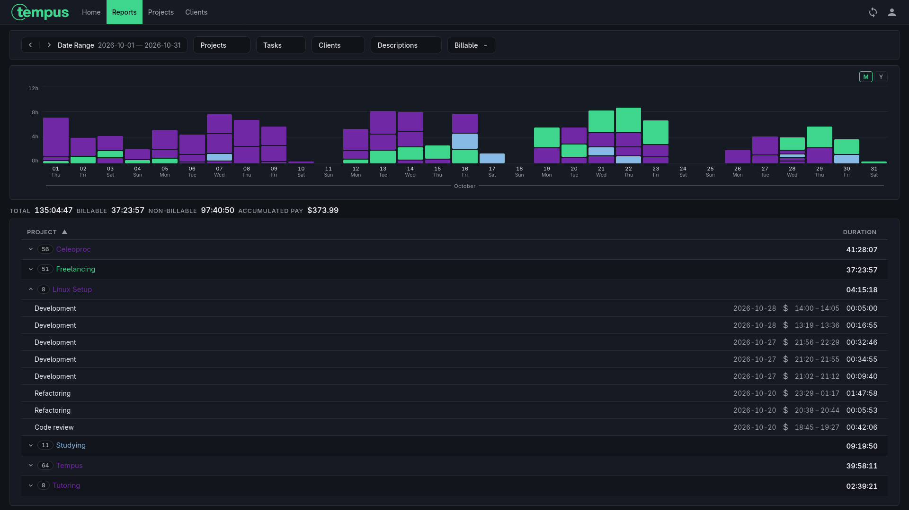
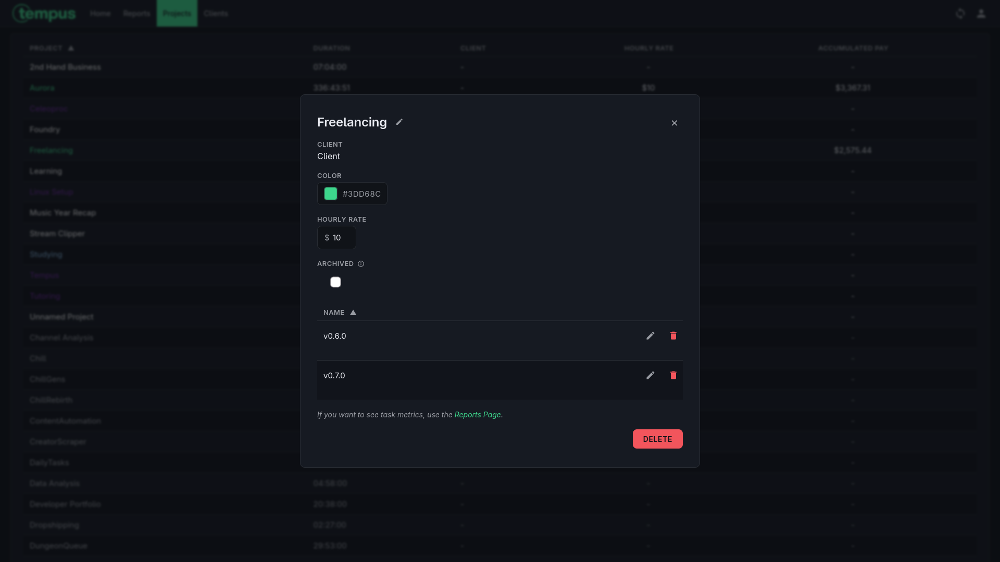
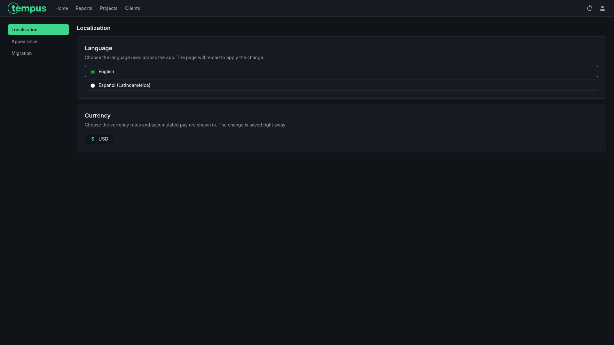
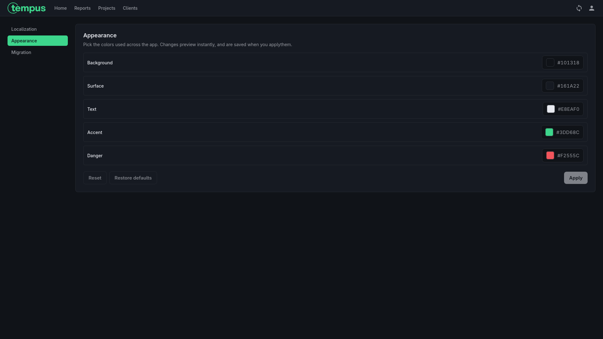

# Tempus


Tempus is a self-hosted time tracking software that supports projects, tasks and clients to ease the gathering of work stats, be it personal or billable work.

The app is heavily inspired by Clockify, mainly because it was created as an alternative to it after they started removing essential features (at least for me) from the free tier and it became apparently slower over time as well. If you don't like the general workflow of Clockify, then Tempus probably won't be for you either.

## Features

The way time is tracked is through time entries. Each **time entry** has:

- Project
- Billable status
- Start time
- End time
- Task (optional)

Additionally, every **project** has:

- Color
- Client (optional)
- Hourly rate (optional)



All these attributes help organize time entries into **reports**. These are a filtered list of time entries displaying calculated information such as total billable/non-billable tracked time and accumulated pay (based on assigned hourly rates). Right now, Tempus counts with the following filters:

- Date range
- Project(s)
- Task(s)
- Description(s)
- Client(s)
- Billable status

These filters allow users to generate useful information for employers, project statistics or even just personal use.



Once you are done working on a project, instead of deleting it and losing all of your tracked time entries, you can archive it. Once a project is archived, it won't show in the project selector for new time entries, but the data will still be there for any reports you generate.



While tempus is shipped with default colors, language and currency, all of these can be configured in the settings page. Changing the currency WILL NOT convert any previous data into the new currency you set, currencies are purely visual/for reference.





## Data Storage

Being a self-hosted alternative, Tempus stores all of your data locally. Now, one of the things that makes Clockify great is the ability to access the same time entry data from all devices at any time, however, this involves sending all time entries to a remote server, which Tempus never does.

The solution for this is **snapshots**. Every 5 minutes Tempus generates a `snapshot.db` file with the current database into the `data/sync` directory, which is then imported when the app boots or by a manual click if the snapshot file is newer than the current version of the database. This way you have a file you can move to any device running the Tempus app and import all of your time entries.

Now, doing this manually can be slow and annoying, so I personally recommend (and use) [Syncthing](https://github.com/syncthing/syncthing). You set it up in all the devices that have Tempus installed and you share the `data/sync` directory. Now every time a snapshot is generated it is shared across all devices automatically.

## Installation
### Docker

The easiest (and currently only supported) way of installing Tempus is through Docker or Docker Compose. 

Both of these methods will create a Docker container called `tempus` that stores the data in a directory `Tempus` under the home directory, mapped to port `8000` and immediately starts back up every time you boot up your system.

#### Docker Command

```
docker run -d --name tempus -p 8000:8080 --restart unless-stopped -v ~/Tempus:/app/data eeshe/tempus:latest
```

#### Docker Compose

```yaml
services:
  tempus:
    image: eeshe/tempus:latest
    container_name: tempus
    restart: unless-stopped
    ports:
      - 8000:8080
    volumes:
      - ~/Tempus:/app/data/
```

## Usage

To start using Tempus you need to open your web browser and navigate to `http://localhost:PORT`, `PORT` being the port you mapped in your docker setup. If you use the one provided in this repo, it will be `http://localhost:8000`.

You'll be greeted with a login page, you can create an account and then access the home page of the app. Once you are there, you start by clicking the `New Time Entry` button and filling the requested information.

https://github.com/user-attachments/assets/bba02018-af4f-4e19-b55b-58c98a215fb0

## Localization

Tempus supports English (`en-US`) and Latin American Spanish (`es-419`). The language can be changed in `Settings → Language`. The choice is stored in `localStorage` under `tempus.locale` and the page reloads to apply it after clicking one of them.

Translations use Angular's runtime `$localize` support. Source strings are marked in templates and TypeScript, then extracted with:

```sh
npm run i18n:extract
```

This writes `src/locale/messages.en-US.json`. Translation files live next to it as `src/locale/messages.<locale>.json` and are served from `/locale/`. When translating, keep message IDs, `{$...}` placeholder tokens, ICU expressions and inline HTML placeholders unchanged.

## Moving from Clockify

After using Clockify for +4 years, one of my main priorities was making Tempus compatible with previous Clockify data. Now, to my surprise, when I went to export my data from Clockify's reports page, not only did it not let me export more than one month at a time without upgrading from the free tier, it only let me export it in PDF format, which would be a nightmare to parse into SQL format.

Luckily, someone else encountered this issue as well and coded a solution for it, which is what I based Tempus' import feature on. So credits to [ptandler/clockify-export](https://github.com/ptandler/clockify-export). Now, to actually import this data is very simple:

1. Assumming you are already logged in, click on the account icon (top-right icon).
2. Click on `Settings`.
3. Go to `Migration`.
4. Click on `Import from Clockify`.
5. Open or drag in the CSV files generated by the clockify-export tool.
6. Click on `Confirm`.

This will import all the time entries in the CSV file an show any errors that are encountered during the import.
